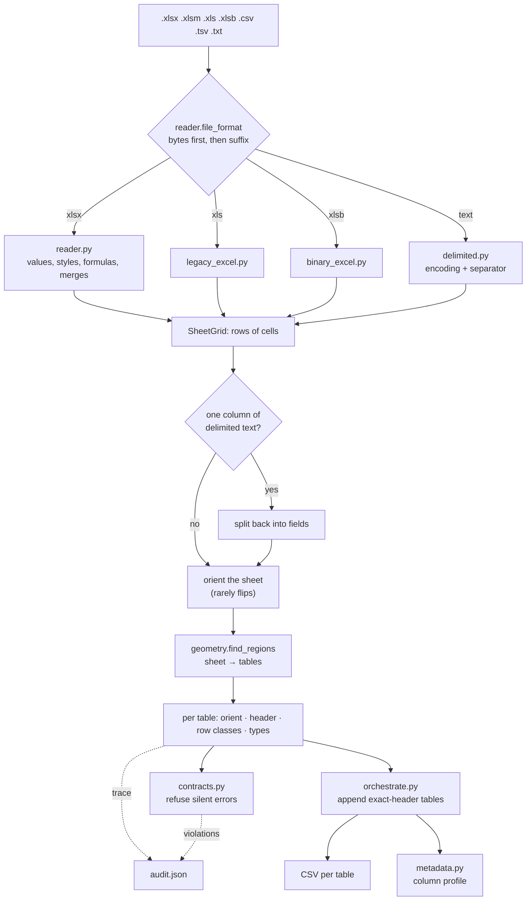
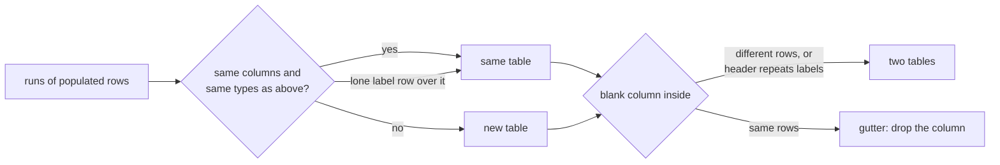
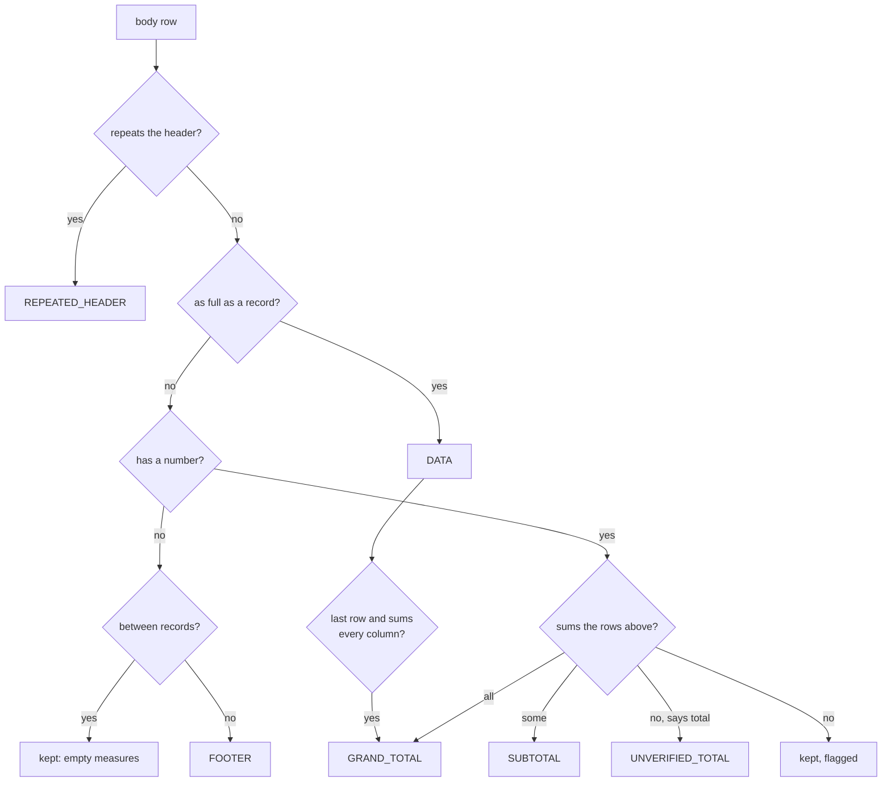

# ahi_clean — architecture and business Q&A

The cleaner has **no schema**. It never looks for a column called "Premium". Every
decision comes from the sheet's own shape, types, fill, distinctness and arithmetic, so a
file it has never seen goes through the same code as a familiar one. Commands are in
[README.md](README.md). The project-level design history is in `/ARCHITECTURE.md`.

## 1. The pipeline

| Module | Job |
|---|---|
| `reader.py`, `legacy_excel.py`, `binary_excel.py`, `delimited.py` | Any input → the same grid of cells |
| `signals.py`, `typing_utils.py` | Scoring primitives: fill, uniqueness, type of a cell, contrast |
| `extract.py` | Orientation, then everything for one table, in order |
| `geometry.py` | Where the tables are on the sheet |
| `header.py` | Which row is the header; column names |
| `rowclass.py` | Which rows are records, and which are totals, banners or notes |
| `pivot.py` | Month-across-the-top matrices |
| `coerce.py` | One type per column |
| `contracts.py` | Checks that refuse plausible-but-wrong output |
| `orchestrate.py` | Appending identical tables; file names |
| `metadata.py`, `audit.py`, `flags.py` | What gets reported |
| `cli.py` | Batch running, error boundaries, exit codes |

## 2. Business questions

### Reading files

**Which files can it read?** `.xlsx`, `.xlsm`, `.xls`, `.xlsb`, `.csv`, `.tsv` and `.txt`.
PDF and `.msg` are not read.

**How does it know a .txt is pipe- or tab-separated?** It tries `,` `;` tab `|` and keeps
the one that gives the *same number of columns* on the most of the first 20 lines.
Frequency alone would pick the comma out of a semicolon file full of prose.

**What if the encoding is wrong?** It tries UTF-8 (with and without BOM), then cp1252,
then latin-1, which never fails. A file always opens.

**A file is password-protected. What happens?** It is reported as `encrypted`, not
`corrupt`. The bytes are checked, because Excel raises the same error for both. The rest
of the batch carries on.

**Someone opened a pipe file in Excel and saved it as .xlsx — every record is one long
string in column A.** If at least 90% of lines sit in column A and split into the same
number (≥2) of `|`, `;` or tab fields, the sheet is split back into columns. Excel may
also have cut some lines on their commas into B and C, so those cells are re-joined
first. The audit notes it.

**Merged cells?** A merge running *down* one column (a carrier written once beside its
policies) is filled down: every record gets the value. A merge running *across* columns
(a title, a group band like "Policy Info", a boxed label) stays one cell. Copying it across
used to hide the blank column between side-by-side tables and turn wide sheets on their
side.

### Finding the tables

**How does it find where a table starts and ends?** It walks blocks of populated rows.
A block joins the one above when it uses the **same columns** (≥70% overlap) holding the
**same kinds of value** (≥70% type agreement). How many blank rows sit between them never
matters.

**Two tables side by side?** Blocks of columns separated by blank columns are split when
they cover different rows. They are also split when they cover the *same* rows but the
right-hand header repeats the left-hand labels (`Carrier | Premium | Revenue` next to
`Month | Premium | Revenue`): two summaries of one measure, not one table.

**A narrow blank column inside one table?** If both sides cover the same rows and do not
repeat labels, it is a decorative gutter and is dropped.

**The header is separated from the records by a blank row.** A lone row of short text
labels attaches to the records below when every column the records fill has a label (the
header may also name up to a quarter more fields that are empty in this extract) and the
labels contrast in type with the values.

### Which way up

**How does it know a sheet is sideways?** It scores both readings. Upright tables hold one
type per *column* and a distinct label line on top; sideways tables do the same along rows.
Types are fine-grained (`id` like `POL-1`, `date`, `int`, `text` …), or business data would
look like "all strings" both ways.

**Can a sheet flip by mistake?** Several guards keep a sheet upright:
- Title rows and banners are removed before the vote.
- A matrix with months across the top is never flipped.
- The whole sheet flips only on a clear margin (0.3). It still does not flip when, read as
  written, it opens with a clear header and the sideways reading has no header and no
  records of its own. This is what an empty template looks like: carriers down the side,
  figures not filled in yet.
- Per table, when the vote is close and only the upright reading has a header, it stays
  upright. A report with two policies and sixteen fields is wider than tall, not sideways.
- Otherwise a close call goes to shape (tables are usually taller than wide) and is
  flagged `confident: false`.

### Headers

**How is the header row found?** Each of the first rows gets a score from five content
signals (weights sum to 1), plus a formatting bonus:

| Signal | Weight | Meaning |
|---|---|---|
| contrast | 0.30 | its cells are text where the column below is numbers, dates or ids |
| textness | 0.25 | labels are words |
| uniqueness | 0.20 | labels don't repeat |
| fill | 0.15 | it is about as full as the records |
| brevity | 0.10 | labels are short |
| emphasis | +0.15 | bold, fill or border the records lack (bonus only) |

The highest score wins if it reaches **0.55**. Ties go to the topmost row.

**What if no row qualifies?** Columns are named `column_1 … column_n` and the audit says
`header_detected: false`. Naming a data row as the header would be worse.

**Two-row headers?** A second label row directly beneath is merged (`Profit Center` over
`Name` → `profit_center_name`) only if it scores ≥0.55 *and* contrasts with the data
(≥0.5). The contrast gate stops the first record of an all-text table being swallowed.

**A heading broken over three or four lines (PDF converted to Excel)?** Rows under the
header join it when they hold **no digit at all**, have at least two cells, and the
records below carry digits in at least two number, date or id columns. Then no record can
pass for a heading piece, and an all-text table is never touched. Pieces join per column
with a space, and a word cut mid-way is glued back: `Face` + `Amoun` + `t` → `face_amount`.

**How are names made?** Lower case, non-alphanumerics → `_`. A blank label over a column
with data → `column_<n>`. Duplicates → `name`, `name_2`. A number → `col_2024`. The label
as written is kept for downstream reporting.

### Rows: records, totals, notes

**How does it decide a row is a total, not a record?** Never by wording alone. Arithmetic
decides:
- **Sparse rows** (filled below 60% of a normal record) are candidates. If a number equals
  the sum of the records directly above, the row is a `SUBTOTAL`. If it equals the sum of
  all records above, it is a `GRAND_TOTAL`.
- **The last full row** is also tested, because a total is often the *fullest* row (every
  month filled while each carrier filled one). It is a `GRAND_TOTAL` only if its numbers
  equal their column sums, and either two or more of them do (one column may be a ratio
  like average commission rate) or it carries fewer labels than every record.
- A last record of 30 under records of 10 and 20 is **not** a total. One matching column
  is not enough.

**A row says "Total" but the numbers don't add up?** It is dropped as `UNVERIFIED_TOTAL`
and flagged for review. Stale or rounded totals would corrupt every downstream sum if kept.

**A row with only a name and no figures?** It depends where it sits:
- between records (a carrier with no business this month, in its alphabetical place): it
  is a record with empty figures, kept and flagged
- at the bottom with no numbers (report footer, filter criteria, "Primary Grouping:"):
  `FOOTER`
- over records whose first column is blank: a group label, carried down into them

**The header repeats after a page break?** It is caught when it repeats verbatim, in part,
or restated in other words (text where the column below holds numbers or dates).

**Can a record vanish silently?** No. Every dropped row is logged with its class and
reason, and the row-conservation contract refuses a table whose row counts don't add up.

### Types

**How is a column's type chosen?** By the majority of its own values, then these rules:
- Any value mixing letters and digits (`12AB`), or digit groups joined by `-`, `/` or a
  space (`59808-1658`), keeps the whole column as **text**, so no code is blanked.
- A leading zero (`08085`) keeps it text.
- Same-width, never-repeating whole numbers: text (a code) above 10 values, a number at 10
  or fewer. Always flagged.
- Mostly parseable dates → a date column, written `YYYY-MM-DD`. Ambiguous day/month is
  read month-first and flagged.
- `$1,234`, `(500)`, `12%` → numbers, with what was removed flagged. A thousands mark
  must group threes: `$1,000,0` is not read as 10000, and `2.500,75` in a US column is
  not read as 2.50075. Such a value fails, and the column stays text (below).

**Can a real value be blanked by typing?** No. Only missing markers (`NULL`, `N/A`, a `0`
standing for "no date") may become empty. If reading a column as numbers or dates would
blank any value containing a digit (group policy `9906-78-32` that looks like a date, an
amount cut to `$1,000,0` by a PDF conversion), the whole column is kept as text and
flagged. The `value_nulled` contract checks this holds.

### Outputs

**When are two tables appended?** Only when their header names match exactly (in any
order). Seven of eight names in common ships two CSVs. `--no-append` turns appending off.
Tables are never joined.

**A sheet of notes (SQL comments, long sentences)?** Not a table: when every value under
the first row starts with `--` or runs past 80 characters, nothing is shipped.

**What do I get per table?** A CSV with the file's own column names, a metadata CSV (type,
counts, nulls, min/max/sum, flags) and, per input, an audit JSON.

### Safety

**What are the contracts?** Checks that refuse rather than report:

| Contract | Catches |
|---|---|
| row conservation | a record leaving without a logged reason |
| key column not empty | values shifted one column left |
| empty column explained | several columns emptying at once |
| removed total reconciles | kept rows no longer matching the dropped total |
| no duplicate column names | defence in depth |
| no value nulled | a value with digits blanked by a type conversion |

**What if one file in a batch is broken?** It costs that file only. The failure is
classified (`corrupt`, `encrypted`, `unsupported_format`, `too_large`, `missing`,
`unexpected`) with advice, and the batch continues.

## 3. Known limits

- PDF and `.msg` are not read. Neither are fixed-width (space-aligned) text files.
- A heading the PDF conversion placed over two columns names only the first of them; the
  second is positional (`column_5`).
- A one-column list is a table only when nine in ten of its values are one non-text type
  (dates, numbers, ids); a column of words stays banners.
- A sideways table that is also tiny (two records) is decided by shape and flagged
  `confident: false`.
- Report-parameter sheets ("Parameter Page") are dropped as banners, not kept as metadata.
- Leading zeros already lost in an `.xlsx` cannot be recovered.
